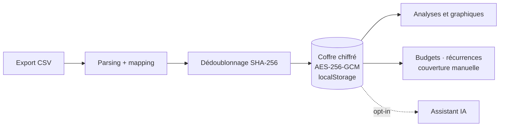

# Budget Analyzer

**Analysez vos relevés bancaires sans jamais les envoyer nulle part.**

Application web locale, installable et utilisable hors ligne, qui transforme
des exports CSV bancaires en tableau de bord budgétaire complet : import et
dédoublonnage, coffre chiffré dans le navigateur, timeline de solde,
couverture des dépenses par les revenus, budgets, détection des paiements
récurrents et assistant conversationnel facultatif.

[](https://react.dev)
[](https://www.typescriptlang.org)
[](https://vite.dev)
[](https://tailwindcss.com)
[](LICENSE)
[](#-confidentialité)

> Aucun serveur, aucun compte, aucune télémétrie. Vos données restent dans un
> coffre chiffré de votre navigateur.

---

## Sommaire

- [Fonctionnalités](#-fonctionnalités)
- [Confidentialité](#-confidentialité)
- [Démarrage rapide](#-démarrage-rapide)
- [Importer un relevé](#-importer-un-relevé)
- [Assistant IA (facultatif)](#-assistant-ia-facultatif)
- [Architecture](#-architecture)
- [Scripts](#-scripts)
- [Tests](#-tests)
- [Limites connues](#-limites-connues)
- [Licence](#-licence)

## ✨ Fonctionnalités

### Import et fiabilité des données

- **Import CSV générique** : séparateurs `;`, `,`, tabulation ou `|`,
  en-têtes français ou anglais, UTF-8 ou Windows-1252, montants FR/US et dates
  `jj/mm/aaaa`, `aaaa-mm-jj` ou `jj-mm-aaaa`.
- **Association manuelle des colonnes** si le format n'est pas reconnu, avec
  aperçu des lignes et reconstruction du solde courant quand la colonne Solde
  est absente.
- **Dédoublonnage idempotent** par ligne brute complète (SHA-256) : réimporter
  un fichier ou un export chevauchant n'ajoute rien, tout en conservant les
  opérations réellement identiques (multiensemble).

### Coffre et confidentialité

- **Coffre local chiffré** AES-256-GCM dans `localStorage`, clé dérivée du mot
  de passe par PBKDF2-SHA256 (310 000 itérations, sel aléatoire, IV neuf à
  chaque écriture).
- **Verrouillage** manuel ou fermeture de l'onglet : la clé ne vit qu'en
  mémoire. Le mot de passe n'est jamais stocké en clair ; si une clé d'accès
  est configurée, une copie chiffrée par son secret PRF est conservée pour le
  déverrouillage.
- Onboarding en trois étapes : mot de passe (+ clé d'accès facultative) →
  premier relevé (facultatif) → IA (opt-in).

### Analyse budgétaire

- **Période globale** partagée par toutes les pages : 30 j, 90 j, 6/12/24 mois,
  historique complet ou plage personnalisée, ancrée sur la dernière opération
  (pas sur la date du jour).
- **Vue d'ensemble** : entrées, dépenses, net, taux d'épargne, comparaison avec
  la période précédente, prochaines échéances et top catégories.
- **Timeline de solde** synchronisée avec la période ; un clic sur une barre
  mensuelle ouvre directement les transactions correspondantes.
- **Analyses** : séries mensuelles, répartition par catégorie, dépenses par
  jour de la semaine, faits saillants.
- **Budgets mensuels** par catégorie ou globaux, avec jauges vert / orange /
  rouge (80 % et 100 %).
- **Récurrences** détectées automatiquement (fréquence, régularité, montant,
  prochaine échéance au jour ouvré, équivalent mensuel). Chaque série doit être
  **acceptée** avant de compter dans les totaux ; refusées et terminées sont
  masquées par défaut.
- **Traitement manuel des paiements** : plus de classement automatique. Chaque
  paiement de la période (y compris les virements) est traité un par un, du plus
  récent au plus ancien par défaut, avec une file de travail, un état à traiter /
  partiel / traité, et une affectation à un ou plusieurs revenus. Les revenus
  sont triés par proximité temporelle avec le paiement — avant comme après — et
  toutes les entrées restent accessibles. Le budget de la catégorie est affiché
  pour les mois autour de la date. Une affectation complète passe
  automatiquement au paiement suivant. Un revenu postérieur est autorisé pour
  gérer un découvert. Un solde négatif antérieur est absorbé par les crédits
  actifs les plus anciens pour que les fonds affichés restent cohérents avec le
  compte.
- **Saisie rapide** de dépenses et recettes depuis le bouton central « + » ou
  la page Saisie manuelle : type, montant, libellé unique, catégorie pleine
  largeur, date et note optionnelle. Le solde et la couverture sont recalculés
  sans rupture de chaîne.

### Application mobile et hors ligne

- **PWA installable** : manifest, icônes, service worker, lancement en mode
  standalone et mise à jour contrôlée. Le service worker ne met en cache que
  les assets statiques, jamais le coffre ni les requêtes IA.
- **Hors ligne complet** pour les fonctions locales : déverrouillage, import,
  analyses, budgets, récurrences, couverture, saisie manuelle et réglages.
- **Navigation mobile** : barre d’onglets basse Accueil / Transactions / + /
  Budgets / Plus, bouton central pour ajouter une dépense, feuille « Plus »,
  période en feuille inférieure, listes tactiles à la place des tableaux,
  panneau de détail plein écran et dialogues en feuilles inférieures.
- **IA explicitement en ligne** : hors réseau, une popup explique que
  l’assistant nécessite une connexion et que le reste de l’application reste
  disponible. Aucun appel réseau n’est tenté.
- **Sauvegarde du coffre** : export/restauration de l’enveloppe chiffrée,
  écran de récupération si le coffre est illisible, file d’écriture sérialisée.
- **Clé d’accès (passkey)** : déverrouillage par Face ID, Touch ID, Windows
  Hello ou gestionnaire de clés, via l’extension WebAuthn PRF. Le mot de passe
  reste le secours ; la clé est propre à l’appareil et n’est pas incluse dans
  l’export.

### Organisation

- **Marchands** : classement par volume, renommage et catégorisation
  persistés — les imports futurs héritent des choix.
- **Transactions** : recherche, filtres, tri par colonne, pagination, export
  CSV de la sélection, panneau des opérations de la même source.
- **Panneau de détail** en colonne scindée : une récurrence ouvre ses
  paiements, un marchand son historique, une transaction les opérations de sa
  source.
- Catégorisation automatique par mots-clés (15 catégories) et nettoyage des
  libellés bancaires tronqués.

## 🔒 Confidentialité

| Ce qui est stocké | Où |
| --- | --- |
| Opérations, alias, budgets, récurrences, conversation | Coffre chiffré `budget.vault.v1` (`localStorage`) |
| Clé dérivée | Mémoire uniquement, effacée au verrouillage |
| Clé API de l'assistant (si activé) | Dans le coffre chiffré |
| Clé d'accès (si configurée) | `budget.passkey.v1` : mot de passe scellé par le secret PRF de la passkey |
| Mot de passe | Jamais en clair ; scellé par la clé d'accès si elle est configurée |

- Pas de backend, pas de compte, pas d'analytics. Le build est 100 % statique.
- **Aucune récupération de mot de passe possible** : mot de passe perdu =
  données illisibles (un avertissement le rappelle à la création).
- WebCrypto exige un contexte sécurisé : `localhost` ou HTTPS. `file://` ne
  fonctionne pas.
- L'assistant IA est **désactivé par défaut** ; quand il est activé, il reçoit
  des agrégats et le résultat d'outils en lecture seule, jamais un IBAN.

## 🚀 Démarrage rapide

Prérequis : Node.js 20+ et npm.

```bash
git clone https://github.com/RedsTom/budget-analyzer.git
cd budget-analyzer
npm install
npm run dev
```

Ouvrez l'URL affichée (`http://localhost:5173`), créez un mot de passe, puis
importez un relevé.

Pour tester la PWA et le service worker :

```bash
npm run build
npm run preview
```

Le service worker n’est pas activé dans `npm run dev`. Il exige HTTPS ou
`localhost`. Pour GitHub Pages, définir `VITE_BASE=/budget-analyzer/` au build.

**Ne pas ouvrir `dist/index.html` en `file://`** : WebCrypto, les modules ES et
le service worker y sont bloqués.

## 📥 Importer un relevé

Format historique reconnu automatiquement : export bancaire français séparé par
`;`, encodé en Windows-1252.

```csv
Date;Date de valeur;Débit;Crédit;Libellé;Solde
25/08/2026;25/08/2026;;1500,00;VIR SALAIRE ACME;1540,00
25/08/2026;25/08/2026;-6,99;;PRLV SEPA FOURNISSEUR EXEMPLE;1533,01
```

<details>
<summary>Règles de lecture (cliquez pour ouvrir)</summary>

- `Débit` est **déjà négatif** : ne pas réinverser le signe (une option existe
  pour les exports qui publient des débits positifs).
- `Débit` et `Crédit` ne sont jamais renseignés ensemble.
- `Solde` est un solde courant continu dans l'ordre du fichier ; l'ordre du
  fichier fait foi, ne pas trier sur `Date de valeur`.
- Sans colonne Solde, un solde courant est reconstruit depuis 0 : ce n'est
  qu'une commodité d'affichage, pas une rupture de chaîne bancaire.
- Les libellés sont conservés bruts (`rawLabel` immuable) ; le renommage ne
  s'applique qu'à l'affichage et reste stocké dans le coffre.

</details>

## 🤖 Assistant IA (facultatif)

Intégration optionnelle de l'API Gemini, désactivée par défaut.

- Clé API saisie par l'utilisateur, chiffrée dans le coffre.
- Le chat interroge les données via **11 outils en lecture seule** (résumés de
  période, recherche d'opérations, marchands, catégories, budgets, récurrences,
  couverture…) et affiche ensuite 1 à 3 cartes d'artefacts cliquables.
- Les fonctions d'analyse (renommage de marchands, catégorisation, suggestions
  de budgets) n'envoient que des agrégats.
- Repli automatique entre deux modèles en cas de saturation du service.

## 🧱 Architecture



```
src/
  app/         routes.tsx — registry des pages, lazy loading et navigation
  lib/         csv, dedupe, crypto, labels, runway, analytics, categories,
               recurring, period, ai, ai-errors, ai-notify, connectivity,
               persist-queue, manual-ledger, storage, vault-backup, passkey,
               assistant-tools, markdown, router…
  store/       vault-store (données chiffrées) · ui-store (période globale,
               filtres, panneau de détail) · ai-notice-store
  hooks/       use-period, use-online, use-media-query
  pages/       overview, analysis, budgets, assistant, transactions,
               recurring, merchants, coverage, manual-entry, settings
  components/  app-shell, mobile-tab-bar, period-picker, data-list,
               quick-transaction-sheet, payment-allocation-dialog,
               ai-notice-dialog, theme-provider,
               vault-recovery-screen, pwa/ (update-prompt, install-card),
               balance-timeline,
               csv-importer, detail-panel, entity-panels,
               assistant-artifacts, ui/ (shadcn)
```

Navigation par hash, sans serveur : `#/overview`, `#/analysis`, `#/budgets`,
`#/assistant`, `#/transactions`, `#/recurring`, `#/merchants`, `#/coverage`,
`#/manual`, `#/settings`.

Les règles métier détaillées (format des relevés, dédoublonnage, chiffrement,
modélisation) sont documentées dans [`AGENTS.md`](AGENTS.md).

## 🛠️ Scripts

| Commande | Effet |
| --- | --- |
| `npm run dev` | Serveur de développement Vite |
| `npm run build` | `tsc -b` puis build de production |
| `npm run preview` | Aperçu du build |
| `npm run test` | Tests Vitest (une passe) |
| `npm run test:watch` | Tests en surveillance |
| `npm run lint` | ESLint |
| `npm run typecheck` | TypeScript seul |
| `npm run pwa:assets` | Régénère les icônes PWA depuis `public/app-icon.svg` |

Ordre de vérification avant de livrer :
`npm run lint && npm run test && npm run build`.

## 🧪 Tests

Vitest, environnement `node`, tests dans `src/lib/` (dont file d’écriture,
grand livre manuel, erreurs IA et récupération du coffre).

```bash
npm run test
```

Les tests d'intégration CSV s'exécutent **uniquement si les relevés de
référence sont présents localement** — ils ne sont pas versionnés, car ce sont
de vraies données bancaires. Pour les activer :

```bash
mkdir -p fixtures
# placez-y releve-complet.csv et releve-partiel.csv
npm run test
```

Couverture principale : parsing CSV, dédoublonnage, crypto (aller-retour, IV,
mauvais mot de passe), périodes, analytique, récurrences, couverture manuelle,
assistant (outils et boucle de function calling), prompts IA.

## ⚠️ Limites connues

- Mono-utilisateur et mono-coffre ; quota `localStorage` ≈ 5 Mo (largement
  suffisant pour plusieurs milliers d’opérations).
- Interface en français, devise EUR, locale `fr-FR`.
- Pas de synchronisation bancaire : l’import se fait par fichier CSV.
- Pas de récupération de mot de passe, par choix de sécurité.
- La clé d’accès dépend du gestionnaire de clés et de la prise en charge de
  WebAuthn PRF ; si elle n’est pas disponible, le mot de passe reste la méthode
  d’accès. Elle ne remplace pas une sauvegarde du coffre.
- L’IA nécessite Internet ; le reste de l’application fonctionne hors ligne.
- Pas de notifications push : elles exigeraient un serveur, incompatible avec
  le fonctionnement 100 % local.
- Sur iOS, l’installation passe par Safari → Partager → « Sur l’écran
  d’accueil ». Pensez à exporter régulièrement le coffre chiffré.

## 📄 Licence

Distribué sous [GNU General Public License v3.0](LICENSE).

---

Réalisé par [RedsTom](https://github.com/RedsTom).
